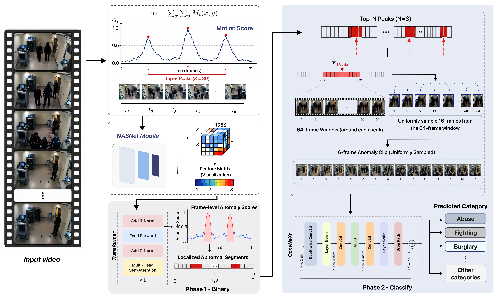

<div align="center">
<h1>Two-Phase NASNetMobile–Transformer Pipeline for Weakly Supervised Video Anomaly Detection and Fine-Grained Crime Classification</h1>

[](https://csonet-conf.github.io/csonet26/index.php/accepted-papers/index.html)

</div>

> *This project was developed as a Graduation Thesis at the **University of Information Technology – Vietnam National University, Ho Chi Minh City (UIT-VNUHCM)**.*
> 
> ***Faculty of Information Systems, University of Information Technology, Ho Chi Minh City, Vietnam***

---

## 📣 News
* **[2026-09]** Our paper *"Two-Phase NASNetMobile–Transformer Pipeline for Weakly Supervised Video Anomaly Detection and Fine-Grained Anomaly Classification"* has been accepted by **CSoNet 2026**! 🎉

---

## 📖 Abstract

> *Video anomaly detection (VAD) in untrimmed surveillance footage remains challenging because abnormal events are sparse, context-dependent, and fine-grained anomaly categories often exhibit visual ambiguity. Existing weakly supervised methods mainly focus on binary anomaly detection, leaving the connection between temporal localization and downstream anomaly categorization underexplored. To address this gap, this study proposes a two-phase cascaded framework that bridges weakly supervised temporal localization and fine-grained anomaly recognition. In Phase 1, Gaussian Mixture Model (GMM)-based motion selection identifies informative frames, NASNetMobile extracts compact spatial features, and a Transformer-based temporal model captures long-range dependencies to produce anomaly scores. In Phase 2, a localization-guided temporal cropping mechanism converts high-confidence anomaly responses into 64-frame clips, which are uniformly sampled into 16-frame sequences and classified at the clip level using lightweight 2D backbones with Temporal Average Pooling. This design reduces temporal redundancy while preserving local event context around suspicious intervals. Overall, the proposed framework provides a modular and computationally efficient baseline for bridging weakly supervised temporal localization and fine-grained anomaly categorization.*

---

## 🏗️ End-to-End Data Workflow

The proposed framework processes long surveillance videos through two connected phases. Phase 1 reduces redundant video data, extracts structured features, and identifies suspicious temporal locations. Phase 2 converts these locations into standardized short clips for fine-grained classification.

<div align="center">
  
</div>

---

## 📊 Datasets

The framework was evaluated on two widely used Video Anomaly Detection datasets:

| Dataset         | Scale                              | Classes               |
| --------------- | ---------------------------------- | --------------------- |
| **UCF-Crime**   | ~128 hours of surveillance footage | 13 anomaly categories |
| **XD-Violence** | 4,754 videos, >217 hours           | 6 anomaly categories  |

Together, the two datasets provide more than **345 hours of unstructured video data** for processing and evaluation.

---

## 🔍 Automated Data Processing

1. **Motion-based frame selection**: GMM-based background subtraction is used to estimate foreground activity and rank frames by motion intensity. The **Top-30 frames** are retained.
2. **Frame standardization**: Selected frames are resized to **224 × 224 pixels**.
3. **Feature extraction**: NASNetMobile converts each selected frame into a **1056-dimensional feature vector**.
4. **Temporal localization**: The resulting **30 × 1056 feature matrix** is passed to temporal models to generate anomaly scores.
5. **Automated clip generation**: The **Top-8 anomaly peaks** are mapped back to the original video. A 64-frame window is extracted around each candidate and uniformly sampled into a **16-frame clip**.
6. **Downstream classification**: Standardized clips are classified into fine-grained abnormal-event categories.

---

## 📈 Phase 1 — Temporal Anomaly Localization

Phase 1 converts structured feature matrices into anomaly scores and candidate temporal locations using Weak supervision with Multiple Instance Learning (MIL) (Top-5 pooling).

### UCF-Crime Results

| Model           |  Video AUC |  Frame AUC |   Frame AP | Event Recall |
| --------------- | ---------: | ---------: | ---------: | -----------: |
| LSTM            |     92.18% |     78.62% |     22.51% |        0.232 |
| **Transformer** |     90.48% | **80.29%** | **25.11%** |    **0.304** |
| TCN             |     90.43% |     73.78% |     18.32% |        0.235 |
| EViT            |     91.22% |     76.45% |     19.87% |        0.254 |
| ST-GNN          | **93.04%** |     77.17% |     19.74% |        0.301 |

**Conclusion:** **Transformer** was selected as the final Phase 1 backbone due to its stronger localization-oriented metrics, which is crucial for accurate downstream clip generation.

---

## 📉 Phase 2 — Fine-Grained Crime Classification

Phase 2 classifies the standardized clips generated from Phase 1. 

### UCF-Crime Results

| Classifier        |   Accuracy | Precision |   Recall | Macro F1 |    Inference |
| ----------------- | ---------: | --------: | -------: | -------: | -----------: |
| **ConvNeXt-Tiny** | **41.18%** |  **0.39** | **0.35** | **0.35** | **20.21 ms** |
| Swin-T            |     39.74% |      0.35 |     0.33 |     0.33 |     23.93 ms |

**Conclusion:** Considering its stronger overall performance on UCF-Crime and competitive efficiency across datasets, **ConvNeXt-Tiny** was retained as the Phase 2 classifier in the final proposed pipeline.

---

## 💻 Processing & Monitoring System

In addition to the experimental framework, the project includes a web-based prototype for managing the video analysis workflow. The application uses relational storage (SQLite) and a React+FastAPI stack to connect the analytical pipeline with a user-facing workflow:

```text
Upload → Process → Analyze → Store → Monitor → Review → Export
```

* **Dashboard & Reporting:** Provides overview statistics, processing monitoring, anomaly analysis results, historical records, alerts, and user feedback.
* **CSV Export:** Structured output can be exported for downstream analytical workflows.

---

## 🛠️ Technology Stack

* **Data Processing & Automation:** Python, OpenCV, NumPy, GMM-based motion filtering
* **Machine Learning:** PyTorch, NASNetMobile, Transformer, MIL, LSTM, TCN, ST-GNN, EViT, ConvNeXt-Tiny, Swin Transformer
* **Application:** React, TypeScript, FastAPI, SQLite, REST API
* **Analysis:** 5-fold Cross-Validation, Comparative model evaluation, Sensitivity analysis, CSV reporting

---

## 🌟 Future Improvements

* Scalable batch processing for larger video collections.
* Stronger processing-job orchestration.
* Cloud-based storage for raw and processed data.
* Distributed preprocessing and model/inference optimization.

---

## 📝 Citation

If you find our work useful in your research, please consider citing:

```bibtex
@inproceedings{phat2026twophase,
  title={Two-Phase NASNetMobile–Transformer Pipeline for Weakly Supervised Video Anomaly Detection and Fine-Grained Anomaly Classification},
  author={Phat, Lam Nguyen and Hung, Pham Huy and Ha, Nguyen Thi Hai and Hieu, Nguyen Thi Thanh and Nhut, Nguyen Minh and Thuan, Nguyen Dinh},
  booktitle={CSoNet},
  year={2026}
}
```